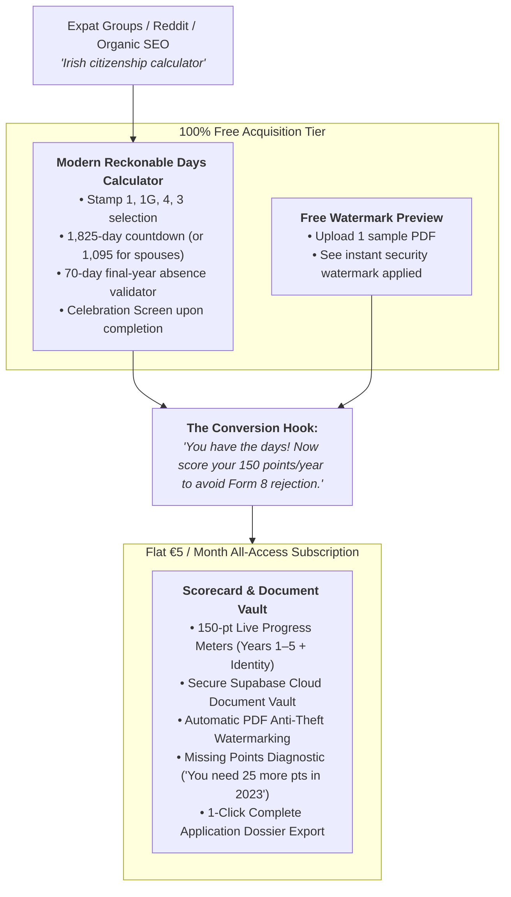
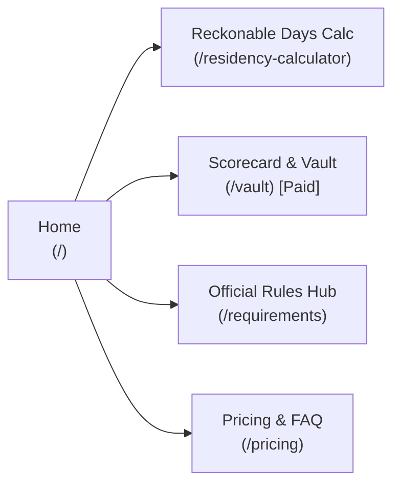

# Irish Citizenship (ISD) Scorecard & Document Vault — Project Specification

---

## 1. Executive Summary & Vision

The platform is a dedicated, high-trust web application designed to help foreign nationals applying for **Irish Citizenship by Naturalisation** navigate the complex requirements set by **Immigration Service Delivery (ISD)** / Department of Justice, Ireland.

It bridges the massive gap between the Irish government's clunky official tools and expensive immigration solicitors (€1,500–€2,500+) by providing:
1. A **100% Free Reckonable Days Calculator** (viral acquisition magnet).
2. A **€5/month Subscription Document Vault & Scorecard Engine** that automatically calculates the official 150-point threshold per year, applies anti-theft watermarks to uploaded PDFs, diagnoses documentation gaps, and compiles an audit-ready application dossier.

---

## 2. Market Gap & Opportunity

* **Government Tool Limitations:** ISD only provides a calculator for counting physical days. For the **Document Scorecard (150 points for identity and 150 points per year of residency)**, the government only provides a dense 20+ page static PDF.
* **Applicant Pain Points:** Tens of thousands of applicants struggle on Reddit (`r/IrishCitizenship`), expat groups, and forums trying to understand:
  * How to reach 150 points for each of the 5 reckonable years.
  * Which documents are accepted (Type A, Type B, Type C).
  * How to ensure their uploaded bank statements and identity documents are not misused.
* **Market Size:** Over **20,000+** citizenship applications are submitted in Ireland every year, with **100,000+** active legal residents (Stamp 1, 1G, 4) currently accumulating their 5-year reckonable clocks.

---

## 3. Product Funnel & Pricing Strategy

### Business Model Details:
* **Pricing:** Flat **€5.00 / month**, cancel anytime with 1 click.
* **Why it works:** Citizenship preparation takes between 3 to 9 months of gathering records. €5/month is trivial for an applicant compared to legal fees, providing high customer lifetime value (LTV).

---

## 4. Multi-Page Site Architecture

1. **Homepage (`/`):**
   * High-trust design (fintech / Irish public service tone).
   * Interactive calculator preview and live demo.
   * Trust and security assurances (GDPR compliant, EU storage, client watermarking).
2. **Reckonable Days Calculator (`/residency-calculator`):**
   * Free standalone tool.
   * Inputs for immigration stamps and date ranges.
   * Absence tracker checking the rolling 70-day maximum in the final continuous year.
   * Direct conversion callout to the Scorecard Vault.
3. **Scorecard & Document Vault (`/vault`):**
   * Member dashboard with year-by-year cards (2020–2024 / 2021–2025).
   * Live points indicator showing real-time totals against the 150-point target.
   * Upload zones for Identity (Passport, Birth Cert, Driving Licence) and Residence (Revenue EDS, Bank Statements, Leases, Utility Bills).
   * PDF preview with active watermarks.
   * 1-Click "Export Application Dossier" button.
4. **Official Guidelines & Requirements Hub (`/requirements`):**
   * Human-friendly breakdown of Form 8 and the ISD scorecard.
   * Deep-linked citations for every single rule.
5. **Pricing & FAQ (`/pricing`):**
   * Clear €5/month breakdown, security details, and cancellation terms.

---

## 5. Security & Watermarking Architecture

Handling sensitive PII (passports, PPSNs, bank statements, tax records) requires bank-grade architecture:

### 1. Original Files Stay Untouched:
* The original PDF on the user's local machine is never modified.
* When uploaded, a watermarked copy is generated and stored in the user's private cloud bucket.

### 2. Automatic Anti-Theft Watermarking:
* **Stamp Content:** 
  `FOR ISD CITIZENSHIP APPLICATION ONLY — [USER ID / DATE]`
* **Styling:** Semi-transparent (12–15% opacity), subtle grey diagonal overlay.
* **Compliance:** Guaranteed never to obscure names, PPSNs, dates, or transaction lines so that ISD caseworkers accept the documents without issue.

### 3. Data Privacy & GDPR:
* Hosted exclusively in the EU (Supabase Frankfurt / Dublin region).
* Row-Level Security (RLS) ensures users can only access their own private vault files.

---

## 6. Official ISD Citation & Deep-Linking System

To build supreme trust, every rule and calculation in the application links directly to the official source on `irishimmigration.ie`:

| Rule / Requirement | In-App Citation Link |
| :--- | :--- |
| **150-Point Identity & Residency Rule** | [ISD Citizenship Guidance Document & Scorecard (PDF)](https://www.irishimmigration.ie/) |
| **Accepted Document Point Tables (A, B, C)** | [ISD Form 8 Naturalisation Scorecard Table](https://www.irishimmigration.ie/) |
| **Eligible / Ineligible Stamp Types** | [ISD Reckonable Residence & Stamp Definitions](https://www.irishimmigration.ie/) |
| **70-Day Final Year Absence Policy** | [Department of Justice Naturalisation Absences Policy](https://www.irishimmigration.ie/) |
| **Spouse of Irish Citizen Criteria (3 Years)** | [ISD Naturalisation on Grounds of Marriage](https://www.irishimmigration.ie/) |

---

## 7. Recommended Technology Stack

* **Frontend:** React / Next.js with **Tailwind CSS** (configured using `ui-ux-pro-max` for accessible, high-trust UI).
* **Backend & Database:** **Supabase** (PostgreSQL, Supabase Auth, Row-Level Security, Encrypted Storage in EU region).
* **PDF Processing:** **`pdf-lib`** (Browser-side / Edge runtime watermarking and PDF manipulation).
* **Payments & Billing:** **Stripe Checkout & Billing Portal** (Handles recurring €5/month subscriptions, cards, Apple Pay, Google Pay, and EU VAT).
* **Hosting:** Vercel or Cloudflare Pages with custom domain (`.ie` preferred, e.g., `CitizenScore.ie`).

---

## 8. Development Roadmap

* [ ] **Phase 1: Specifications & ISD Document Scoring Matrix** (Lock in exact point values and validation logic).
* [ ] **Phase 2: Free Days Calculator** (Interactive stamp input, absence validator, 1,825-day logic).
* [ ] **Phase 3: PDF Watermarking Engine** (Client-side / Edge generation of semi-transparent security stamps).
* [ ] **Phase 4: Supabase Vault & Scorecard Dashboard** (Auth, private bucket storage, multi-year progress rings).
* [ ] **Phase 5: Stripe Subscription Integration** (€5/mo paywall, customer portal).
* [ ] **Phase 6: Knowledge Hub & Official Deep-Links** (SEO-optimized guidance pages).
